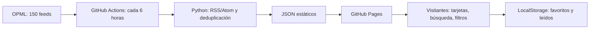

# Radar RSS · Lector público de noticias

**Versión inicial funcional para GitHub Pages + GitHub Actions.**

Proyecto web público, gratuito dentro de las cuotas aplicables de GitHub, sin API privada, backend de tiempo completo, claves ni autenticación. Diseñado para iniciar con 150 fuentes y seis categorías procedentes del OPML consolidado del 17-10-2026.

## Arquitectura



- **Fuentes:** `sources/feeds.opml`. Suscripciones agrupadas en inteligencia artificial, tecnología, internacionales, Chile, Venezuela y Latinoamérica.
- **Colector:** `scripts/collect.py`, Python + feedparser + requests. Obtiene los feeds con concurrencia limitada, normaliza titulares, extractos, imágenes y fechas, deduplica por URL y retiene artículos hasta 45 días. Si un feed falla, mantiene datos antiguos dentro del período de retención gracias a la caché de GitHub Actions.
- **Vigilancia:** `web/data/status.json`. Registra errores, feeds vacíos y feeds con última publicación fechada hace al menos 365 días. Una fuente no se elimina automáticamente: un feed roto no implica un medio inactivo.
- **Publicación:** `.github/workflows/deploy.yml`, GitHub Actions -> GitHub Pages. El navegador consume JSON generado, sin solicitar RSS externos directamente (evita CORS).
- **UI:** `web/index.html`, `web/styles.css` y `web/app.js`. Sin frameworks ni compiladores. Tarjetas/lista, filtros por fuente y categoría, búsqueda, modo claro/oscuro, guardadas y sin leer (por navegador).

## Funciones para lectores

- **Lo más cubierto y el radar.** Las historias publicadas por más medios distintos en 24 h, en una lista numerada y en un radar (sector = tema, distancia = antigüedad, tamaño = cobertura). Es una señal de importancia que no depende de clics.
- **Cómo lo cuenta cada medio.** Al abrir una historia agrupada, los titulares de cada medio, separados por región y fuentes oficiales, sin valoraciones.
- **Seguimiento de una historia.** Línea de tiempo con las notas relacionadas de los últimos días.
- **Temas en alza** (`data/trends.json`). Palabras cuyo uso en titulares crece frente a los 7 días anteriores, con mínimos de historias y de fuentes.
- **Temas que sigo, «Mientras no estabas», Resumen del día** (escuchar, copiar o compartir por WhatsApp) y **atajos de teclado** (`?`). Todo se guarda solo en el navegador.
- **Modo ligero y lectura sin conexión** (`sw.js`): red primero; sin conexión, la última copia del propio sitio.
- **Feeds de salida** en `feeds/`: `mas-cubierto.xml` y uno por carpeta.

## Cómo publicar en GitHub (una sola vez)

1. Crear un **repositorio público** en GitHub llamado, por ejemplo, `radar-rss-publico`. No añadir archivos iniciales al crearlo si subirás esta carpeta completa.
2. Subir **todos los archivos y carpetas**, incluidos `.github/workflows/deploy.yml`, `scripts`, `sources` y `web`. Es importante conservar rutas y estructura.
3. Asegurarse de que la rama principal sea `main`.
4. En el repositorio, abrir **Settings → Pages → Build and deployment → Source → GitHub Actions**.
5. Abrir **Actions → Actualizar noticias y publicar → Run workflow** (si no se ha ejecutado automáticamente por el primer commit). La acción descargará los RSS, generará los JSON y publicará el sitio.
6. Cuando el flujo termine correctamente, el sitio estará normalmente en `https://TU-USUARIO.github.io/radar-rss-publico/`. GitHub muestra la URL real en Settings → Pages.
7. En `web/index.html`, sustituir el enlace del botón **Proyecto ↗** por la URL real del repositorio.

**Opción mediante Git local (después de descomprimir):**

```bash
git init
git branch -M main
git add .
git commit -m "Versión inicial de Radar RSS"
git remote add origin https://github.com/TU-USUARIO/radar-rss-publico.git
git push -u origin main
```

Requiere tener Git instalado y autenticado. No pegues contraseñas ni tokens en el repositorio.

## Prueba local

Requiere Python 3.11+ y acceso a Internet para recopilar noticias:

```bash
python -m pip install -r requirements.txt
python -m unittest discover -s tests -v
python scripts/collect.py --opml sources/feeds.opml --out web/data --days 45
python -m http.server 8000 --directory web
```

Abrir `http://localhost:8000` (no abrir el archivo HTML haciendo doble clic: `fetch` puede estar bloqueado por el navegador).

## Actualización y edición

- **Automática:** aproximadamente cada seis horas mediante cron UTC `17 */6 * * *`. GitHub puede retrasar u omitir alguna ejecución; en repos públicos, la programación puede desactivarse por inactividad prolongada. El flujo también puede iniciarse manualmente.
- **Modificar fuentes:** editar `sources/feeds.opml`, confirmar y esperar el siguiente flujo. No existe límite fijo de 150 en la aplicación, pero más fuentes incrementan consumo de Actions y tiempo de recopilación.
- **Número de artículos:** 12 por feed por ciclo, hasta 2.300 en caché y últimos 45 días por defecto. Ajustable en `deploy.yml` / `collect.py`.
- **Sitio sin noticias después de publicar:** revisar los detalles de `Actions` y `data/status.json`. La aplicación no inventa noticias ni reemplaza automáticamente feeds problemáticos.
- **URL del proyecto:** cambiar el enlace de GitHub en `web/index.html` después de crear el repositorio.

## Límites de la versión 1

- Favoritos y leídos solo en `localStorage` del navegador; no se sincronizan entre dispositivos ni entre visitantes.
- Sin panel para modificar fuentes desde el sitio público. El OPML se administra en el repositorio para prevenir abusos y SSRF.
- La caché entre ejecuciones de GitHub Actions no constituye almacenamiento permanente y puede caducar o ser desalojada. GitHub Pages tampoco es base de datos. Para histórico duradero y actualización casi en tiempo real, implementar backend y base de datos en versión 2.
- Algunos RSS bloquean servidores automatizados, carecen de fechas, publican sin imágenes, están detrás de muros de pago o tienen licencias que restringen su uso. Solo se muestran extractos breves y enlaces a la fuente original.
- La presentación de una publicación como reciente depende de la fecha proporcionada por el editor. No atribuir fechas inexistentes; se conserva la fecha de primera detección como dato distinto.
- La lista OPML puede contener radares de Google Noticias no indexados de forma completa. Son búsquedas temáticas, no feeds directos del periódico.
- Enlace a imagen externa puede mostrar contenido de terceros o no cargar; las imágenes se presentan sin retransmitirse ni descargarse a un servidor propio.

## Seguridad y privacidad

- No se aceptan nuevos RSS enviados por usuarios anónimos. Los feeds están controlados por el mantenedor en Git.
- Se descartan enlaces de artículos e imágenes que no sean HTTP/HTTPS; la UI representa texto RSS con `textContent`, sin insertar HTML no confiable.
- El colector valida destinos públicos antes de consultar una fuente o seguir redirecciones. Esto es una precaución básica, no una garantía absoluta contra SSRF si se habilitara entrada de URLs no confiables.
- No hay analíticas integradas, cuentas, cookies de la aplicación ni secretos expuestos. GitHub Pages y los medios externos pueden recibir datos normales de conexión del navegador.
- Las marcas y publicaciones son de sus respectivos titulares. El proyecto no reproduce textos completos de los medios.

## Estructura

```text
radar-rss-publico/
├── .github/workflows/deploy.yml
├── sources/feeds.opml
├── scripts/collect.py
├── tests/test_collector.py
├── requirements.txt
├── web/
│   ├── index.html
│   ├── styles.css
│   ├── app.js
│   ├── favicon.svg
│   ├── manifest.webmanifest
│   ├── .nojekyll
│   └── data/
│       ├── sources.json
│       ├── articles.json
│       └── status.json
└── README.md
```

## Hoja de ruta

**V1 (este entregable):** lector público estático, importación OPML a configuración, monitor básico de feeds, buscador, filtros, diseño de tarjetas/lista y despliegue automatizado.

**V1.1:** estadísticas de errores y antigüedad de feeds, pruebas periódicas, editor de fuentes solo por Git, reportes de enlaces inactivos y deduplicación semántica opcional.

**V2 (opcional):** usuarios, favoritos sincronizados, base de datos, RSS personalizado, notificaciones, resumen IA bajo demanda, panel administrativo, PWA con caché sin conexión.

## Licencia

Código creado para este proyecto. Puedes publicarlo y modificarlo bajo licencia MIT (`LICENSE`); no se transfieren derechos sobre los contenidos de terceros.