# Eventos · recolector integrado en Radar RSS

Este directorio contiene el recolector del antiguo repositorio `medinacaj/eventos-biobio`, copiado el 2026-10-25 desde su commit `f6d9eef`. Ahora alimenta la sección **Eventos** de Radar RSS (`#eventos`). La documentación original se conserva en [`README_ORIGINAL.md`](README_ORIGINAL.md): las reglas de calidad, las cuarentenas y la política de «Por confirmar» no cambiaron.

## Qué se trasladó y qué no

| Se trasladó | No se trasladó |
|---|---|
| `actualizar.py`, `db.py`, `discovery.py`, `metadata.py`, `images.py`, `scrapers/` | `app.py` y `launcher.py` (servidor local) |
| `config/` (fuentes del Biobío y nacionales, comunas) | `static/` (interfaz local): se reescribió como `web/eventos.js` |
| `data/` (snapshots y eventos semilla) | «Publica tu evento» y «Administración»: requieren servidor, que GitHub Pages no ofrece |
| `scripts/check_snapshot.py`, `scripts/report_coverage.py`, `tests/` (sin la prueba del servidor) | GeoMapa con Leaflet: la política de seguridad (CSP) de Radar solo admite scripts propios; se reemplazó por la vista «Por comuna / Por región» |

Cambio de comportamiento: el `User-Agent` ahora identifica a Radar RSS (`RadarRSS-Eventos/1.0`).

## Flujo

```mermaid
flowchart LR
  A[eventos.yml · diario 11:35 UTC] --> B[recover: último snapshot publicado]
  B --> C[actualizar.py · Biobío y nacional]
  C --> D[check_snapshot.py: exige HTTP 2xx verificable]
  D --> E[Artefacto radar-eventos · 30 días]
  E --> F[deploy.yml · cada 3 h: recover + export]
  F --> G[web/data/eventos.json y web/data/eventos/*.json]
  G --> H[Sección Eventos en GitHub Pages]
```



- **No hay commits automáticos.** A diferencia del repositorio original, ningún workflow escribe en `main`. La continuidad del historial se obtiene del último snapshot publicado en Pages (`data/eventos/biobio.json` y `data/eventos/nacional.json`) o del artefacto del rastreo; `eventos/data/` solo es el punto de partida.
- **Las noticias nunca dependen de los eventos.** El paso de eventos en `deploy.yml` tiene `continue-on-error`: si falla, Radar publica las noticias igual y la sección Eventos muestra el último dato disponible o un aviso.
- **Si una corrida no obtiene ninguna respuesta HTTP 2xx**, se conserva el snapshot anterior y no se entrega un artefacto nuevo.

## Uso local

```sh
python -m unittest discover -s eventos/tests -t eventos          # sin red
python eventos/actualizar.py --workers 4                          # rastreo Biobío (requiere red)
python eventos/actualizar.py --nacional --workers 4               # rastreo nacional
python eventos/publicar_web.py recover --no-pages                 # elige el snapshot más reciente
python eventos/publicar_web.py export --out web/data              # genera los JSON públicos
```

## Revisión jurídico-tecnológica (pendiente de validación por la persona responsable)

| Riesgo | Evidencia | Control aplicado | Estado |
|---|---|---|---|
| Los datos pasan de una app **local** a una web **pública** (redistribución de títulos, fechas, lugares y extractos de terceros). | `README_ORIGINAL.md` describía una app no hosteada. | Se publican solo campos fácticos, extractos de máximo 600 caracteres, enlace y atribución a la fuente en cada ficha. | **Abierto:** confirmar que publicar estos datos es aceptable para las fuentes (términos de uso de cada sitio). |
| Imágenes de terceros. | `image_url` proviene de la fuente. | Solo se muestran en la ficha, enlazadas (no copiadas), con `referrerpolicy=no-referrer`, y se ocultan en modo ligero o sin imágenes. | Abierto: mismo criterio que las noticias de Radar. |
| Carga sobre sitios rastreados. | `scrapers/common.py`. | `robots.txt` respetado, rastreo una vez al día, User-Agent identificable. | Confirmado en código; sin prueba en vivo desde este entorno. |
| Datos personales. | Los eventos describen actividades públicas; Radar no recoge datos de visitantes. | Guardados solo en `localStorage`; sin cuentas ni envío a servidores. | Confirmado en código. |
| Exactitud. | Fichas «Por confirmar» sin datos estructurados. | Nunca se completan campos; aviso visible en cada ficha y en la sección. | Confirmado en código. |
